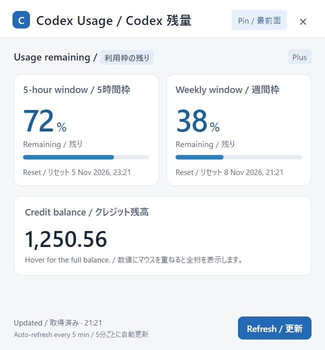
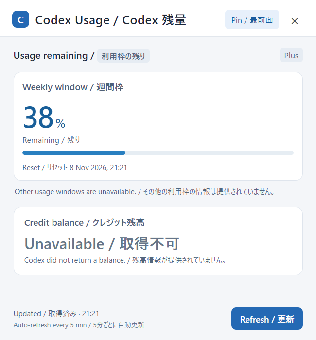

# Codex Usage / Codex 残量

[Download for Windows / Windows版をダウンロード](https://github.com/FURUYAN1234/codex-usage-overlay/releases/latest)

A small Windows overlay for Codex usage limits, reset times and credit balances. The window and system tray show English and Japanese together. / Codexの利用枠の残り、リセット予定時刻、クレジット残高を小さなWindowsウィンドウで確認できます。ウィンドウとトレイは英日併記です。

## Screenshots / 画面



The app refreshes every five minutes. Use **Refresh / 更新** to fetch immediately and **Pin / 最前面** to keep the overlay above other windows. The × button hides it to the tray. To exit, right-click the tray icon and select **Quit / 終了**. / 5分ごとに自動更新します。「更新」で今すぐ取得でき、「最前面」でウィンドウを手前に固定できます。×でトレイに収納し、終了するときはトレイアイコンを右クリックして「終了」を選びます。

Credit balances show up to two decimal places. Hover over the number for the full value. / クレジット残高は小数第2位まで表示します。数値にマウスを重ねると全桁を確認できます。

## Missing information / 取得できない情報



Available windows vary by account. The app shows the windows Codex returns and displays **Unavailable / 取得不可** when the balance is missing. After a failed refresh, it labels any previously fetched values. / 取得できる利用枠はアカウントによって異なります。Codexから返った枠だけを表示し、残高が返らないときは「取得不可」と表示します。更新に失敗したとき、前回の値があればその旨を表示します。

Interrupted connections can trigger up to three read attempts per refresh within a 60-second deadline. Connection interruptions and timeouts have separate messages. / 通信が途切れたときは、1回の更新につき60秒以内に最大3回まで取得を試みます。通信断とタイムアウトは異なる文言で表示します。

## Getting started / 導入

Requires 64-bit Windows and Codex Desktop or Codex CLI on PATH. Sign in to the account you want to monitor in Codex. / Windowsの64bit環境と、Codex DesktopまたはPATHに登録されたCodex CLIが必要です。確認したいアカウントでCodexにログインしてください。

1. Download the Windows ZIP from [Releases / リリース](https://github.com/FURUYAN1234/codex-usage-overlay/releases/latest). / リリースページからWindows用ZIPをダウンロードします。
2. Extract the ZIP and run `Codex Usage.exe`. Keep the accompanying files together. / ZIPを展開し、同梱ファイルと同じフォルダーにある `Codex Usage.exe` を起動します。
3. Wait for the first refresh. If it fails, check your Codex sign-in and click **Refresh / 更新**. / 初回取得を待ちます。取得できない場合はCodexのログイン状態を確認して「更新」を押してください。

The executable is unsigned. This app uses your existing Codex sign-in. / 実行ファイルは未署名です。Codexのログイン状態を利用するため、このアプリへのAPIキー入力は不要です。

### Start at sign-in / Windowsサインイン時の起動

Create a shortcut to `Codex Usage.exe`, press Win+R, open `shell:startup`, and place the shortcut there. Remove the shortcut to disable automatic startup. / `Codex Usage.exe` のショートカットを作成し、Win＋Rで `shell:startup` を開いてその中に置きます。自動起動を解除するときはショートカットを削除します。

## Data handling / データの扱い

The app starts Codex `app-server`, reads usage metadata with `account/rateLimits/read`, and closes its helper process. The app reads usage metadata only. / Codexの `app-server` を起動し、`account/rateLimits/read` で利用枠とクレジットの情報を読み取ったあと、補助プロセスを終了します。

This is an unofficial app. Changes to Codex responses or your environment may affect retrieval. / 非公式アプリです。Codexの返却形式や利用環境が変わると、取得できなくなる場合があります。

## Run from source / ソースからの実行

```powershell
npm ci
npm run smoke
npm start
```

To build and verify the Windows x64 ZIP, run the following from a clean checkout on Windows with Node.js and Python 3 installed. / Windows x64用ZIPを作成して検証するには、Node.jsとPython 3が入ったWindowsで、クリーンなチェックアウトから次のコマンドを実行します。

```powershell
npm ci
npm run pack
python scripts/verify_package.py build
python scripts/verify_package.py verify release-build/CodexUsage-v1.2.0-windows-x64.zip
```

The verifier compares the extracted files against the internal SHA-256 manifest. / 検証スクリプトは、ZIPを展開して同梱のSHA-256マニフェストと照合します。

## License / 利用条件

FURU-owned code is free to use under the [FURU Application Terms / FURU アプリ利用条件](LICENSE), a custom source-available license. Electron and other third-party components retain their respective licenses. / FURUのコードは、ソースを公開する独自の利用条件に基づいて無料で利用できます。Electronなど第三者の部分には、それぞれのライセンスが適用されます。
