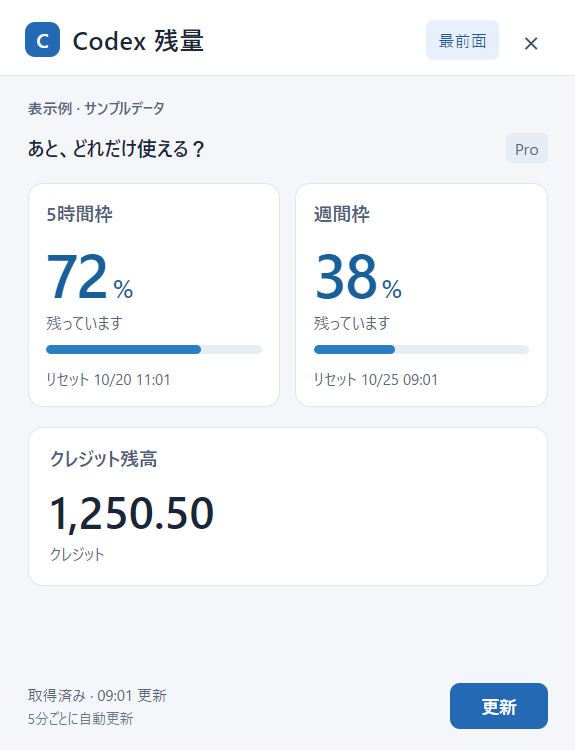
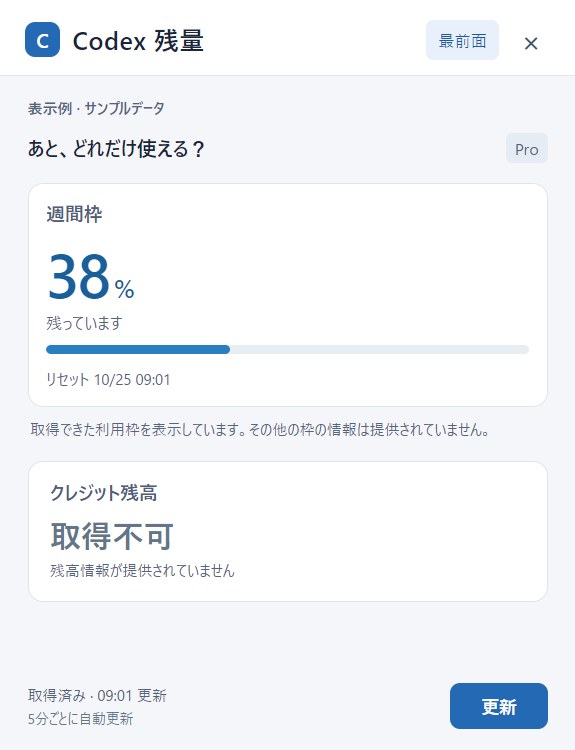

# Codex 残量 / Codex Usage


Codexの利用枠があと何％残っているか、クレジットがいくつ残っているかを、小さなWindowsウィンドウに表示します。

A small Windows app that shows the remaining percentage of your Codex usage windows and your credit balance. The application UI is in Japanese.

[Windows版をダウンロード](https://github.com/FURUYAN1234/codex-usage-overlay/releases/latest)

[Download for Windows](https://github.com/FURUYAN1234/codex-usage-overlay/releases/latest)

## 画面 / Screenshots



画像はサンプル値を使った表示例です。サムネイルは紹介用のイメージです。

Screenshots use sample values. The cover is an illustrative thumbnail.

残りの割合、リセット予定時刻、クレジット残高を別々に表示します。残高は小数第2位まで表示し、数値にマウスを重ねると取得した値を確認できます。

Remaining percentages, reset times and credits are shown separately. Credits are displayed to two decimal places; hover over the number to see the full returned value.

「更新」で再取得でき、5分ごとにも自動更新します。「最前面」で他のウィンドウより手前に固定できます。右上の×はトレイに収納する操作です。終了するときは、トレイのアイコンを右クリックして「終了」を選んでください。

Click 「更新」 (Refresh) to fetch the latest values. The app also refreshes every five minutes. 「最前面」 toggles always-on-top mode. The × button hides the window to the system tray. To quit, right-click the tray icon and select 「終了」.

## 提供されない情報 / Missing information



取得できる利用枠はアカウントによって異なります。5時間枠や週間枠が常に両方返るとは限りません。返らない利用枠は補完せず、残高が返らなければ「取得不可」と表示します。取得に失敗したときに前回の値があれば、その値であることを明示します。

Available usage windows vary by account. Codex does not always return both five-hour and weekly windows. Missing windows are not filled with invented values, and an unavailable balance is shown as 「取得不可」. If a refresh fails and previous data exists, the app labels it as previously retrieved data.

通信が途中で切れた場合は、1回の更新につき最大3回まで取得を試みます。初回からの待ち時間は合計60秒までです。認証などのエラーは繰り返しません。通信断やタイムアウトは、画面に理由を分けて表示します。

If a connection drops, the app makes up to three read attempts within the original 60-second refresh deadline. Authentication and other permanent errors are not retried. Connection interruptions and timeouts have distinct error messages.

トークン数から残りの割合や料金を推定する機能はありません。

The app does not estimate remaining percentages or costs from token counts.

## 導入 / Getting started

Windowsの64bit環境向けです。Codex Desktop、またはPATHに登録されたCodex CLIが必要です。利用したいアカウントでCodexにログインしておいてください。

Requires 64-bit Windows and Codex Desktop, or a Codex CLI available on PATH. Sign in to Codex with the account you want to monitor. If your Desktop installation is not detected, make the Codex CLI available on PATH.

1. [配布ページ](https://github.com/FURUYAN1234/codex-usage-overlay/releases/latest)からWindows用ZIPをダウンロードします。
2. ZIPを展開し、フォルダー内の `Codex Usage.exe` を起動します。同梱ファイルは一緒に置いてください。
3. 初回の取得を待ちます。取得できない場合はCodexのログイン状態を確認し、「更新」で再取得します。

1. Download the Windows ZIP from the [release page](https://github.com/FURUYAN1234/codex-usage-overlay/releases/latest).
2. Extract it and run `Codex Usage.exe`. Keep the accompanying files together.
3. Wait for the initial fetch. If it fails, check that Codex is signed in, then click 「更新」.

本アプリにAPIキーを入力する必要はありません。実行ファイルにはコード署名が付いていません。

No API key entry is required in this app. The executable is not code-signed.

### Windowsサインイン時の起動 / Start at sign-in

`Codex Usage.exe` のショートカットを作り、Win＋Rで `shell:startup` を開いて、その中に置きます。解除するときは、そのショートカットを削除します。

Create a shortcut to `Codex Usage.exe`, press Win+R, open `shell:startup`, and place the shortcut there. Remove that shortcut to disable automatic startup.

## データの扱い / Data handling

Codexの `app-server` を起動し、`account/rateLimits/read` で残量情報を読み取ります。本アプリが会話履歴を走査したり、認証ファイルを直接読み出したりすることはありません。生成の実行、クレジットの購入・リセットも行いません。取得処理を終えたら子プロセスを終了します。

The app starts Codex `app-server` and reads usage metadata through `account/rateLimits/read`. It does not scan conversations or directly read authentication files. It does not run generations, purchase credits or reset balances. The child process is closed after each fetch.

これはOpenAIの公式アプリではありません。Codexの返却形式や利用環境の変更により、取得できなくなる場合があります。

This is an unofficial app, not an OpenAI product. Changes to Codex responses or your environment may affect retrieval.

## ソースからの実行 / Run from source

```powershell
npm ci
npm run smoke
npm start
```

`npm run pack` でWindows用のフォルダーを `release-build/win-unpacked/` に作成します。残量の正規化、読み取り専用RPC、タイムアウト、キャンセル、子プロセス終了などの回帰テストを含みます。

`npm run pack` builds a Windows application folder at `release-build/win-unpacked/`. Tests cover normalization, read-only RPC boundaries, timeouts, cancellation and child-process shutdown.

## 利用条件 / License

無料で利用できます。FURUのコード部分には [FURU アプリ利用条件](LICENSE) が適用されます。ソースを公開する独自の条件であり、OSIの定義によるオープンソースライセンスではありません。Electronなど第三者の部分には、それぞれのライセンスが適用されます。

Free to use under the [FURU Application Terms](LICENSE) for FURU-owned code. These are custom source-available terms, not an OSI open-source license. Third-party components, including Electron, retain their respective licenses.
